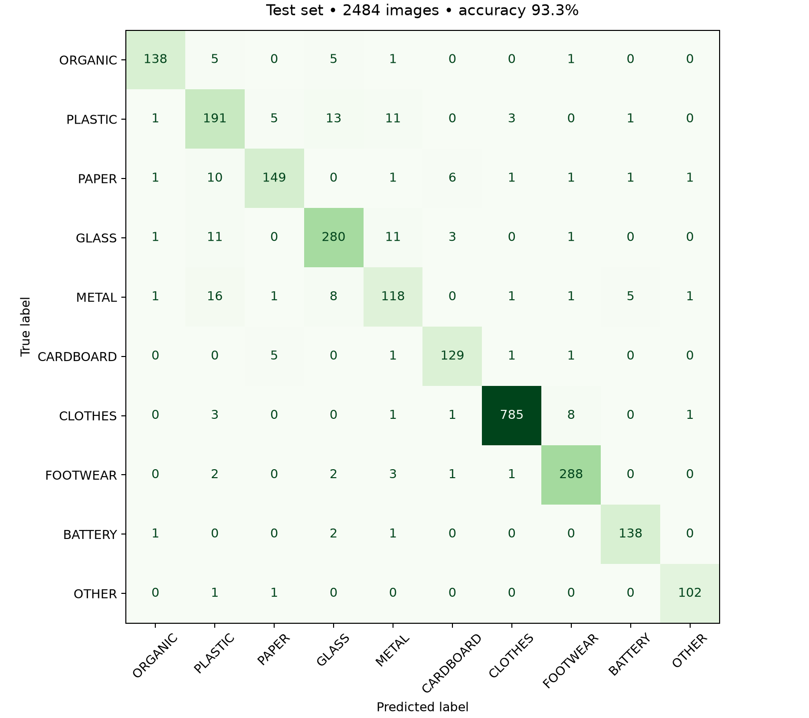

# Siklus waste classifier with human corrections

The current clothing-correction release reaches 93.32% accuracy on 2,484 held-out samples across ten categories. The preceding paper-correction release reached 93.00% on the same test paths.

| Category | Precision | Recall | F1 | Test samples |
| --- | ---: | ---: | ---: | ---: |
| ORGANIC | 0.9650 | 0.9200 | 0.9420 | 150 |
| PLASTIC | 0.7992 | 0.8489 | 0.8233 | 225 |
| PAPER | 0.9255 | 0.8713 | 0.8976 | 171 |
| GLASS | 0.9032 | 0.9121 | 0.9076 | 307 |
| METAL | 0.7973 | 0.7763 | 0.7867 | 152 |
| CARDBOARD | 0.9214 | 0.9416 | 0.9314 | 137 |
| CLOTHES | 0.9912 | 0.9825 | 0.9868 | 799 |
| FOOTWEAR | 0.9568 | 0.9697 | 0.9632 | 297 |
| BATTERY | 0.9517 | 0.9718 | 0.9617 | 142 |
| OTHER | 0.9714 | 0.9808 | 0.9761 | 104 |

## Training and selection

The MobileNetV2 backbone remains frozen. Its classifier head learns from source-data rehearsal and four human-confirmed training corrections: METAL rusty cans, GLASS bottle bucket, PAPER newspaper pile and CLOTHES clothing pile. Each correction contributes 64 augmented views with sample weight 2. Training includes all source training examples for clothes, paper, footwear, glass, metal, plastic and cardboard, and up to 300 per other category. Each class receives 64 four-photo same-class mosaics; all parents belong to the training split. Source paths and hashes are retained.

Epoch 3 was selected by validation loss. All predeclared gates passed. Validation CLOTHES F1 changes from 0.98809 to 0.98812; PAPER F1 decreases from 0.87647 to 0.87087, within the predeclared one-point tolerance. This release does not improve every class. Full comparison: experiments/feedback-clothes/validation-comparison.json. See CLOTHES_REFINEMENT.md, PAPER_REFINEMENT.md and FEEDBACK_TRAINING.md for the successive stages.

Bottle-consensus inference uses OpenCV Zoo YOLOX proposals and the trained classifier on bottle crops. Model metadata retains the detector checksum. The earlier 224px experiment was rejected.

## Limitations

All four correction photos pass backend normalization and the full frontend upload flow, including category filters. They were used for training and therefore are regression checks, not independent evidence of field accuracy. No correction photo is counted in validation or test. The benchmark has been reused across model iterations; new independent field photos are required to establish general field performance.

One category is emitted per photo, so mixed and cluttered scenes remain difficult. OTHER follows the source trash class and is not a universal unknown detector. Scores are uncalibrated. Increasing the score on a training correction does not demonstrate generalization to unseen clothing piles.

The previous release is preserved in artifacts/before-clothes-feedback. Source hashes, train-only feedback groups, training history, per-image test predictions, source metrics, detector license and provenance remain available.

Active version: mobilenetv2-feedback-b5d5aef88ddd

Classifier SHA-256: b5d5aef88ddd4e4919d98e23a3bb818a88503d2e824c77ad651ee57fee23e6f5
